<picture>
  <source media="(prefers-color-scheme: dark)" srcset="assets/banner-dark.svg">
  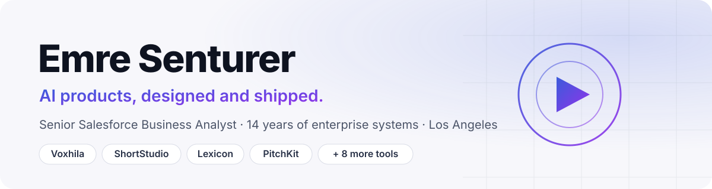
</picture>

  <a href="https://voxhila.com"><b>voxhila.com</b></a> ·
  <a href="https://linkedin.com/in/emresenturer"><b>LinkedIn</b></a> ·
  <a href="#live-tools"><b>Live tools</b></a>

I turn complex business processes into systems that work. Fourteen years across Salesforce ecosystems and enterprise integrations, now designing and shipping AI products end to end: product, design, code and launch.

## Flagship: Voxhila

<a href="https://voxhila.com">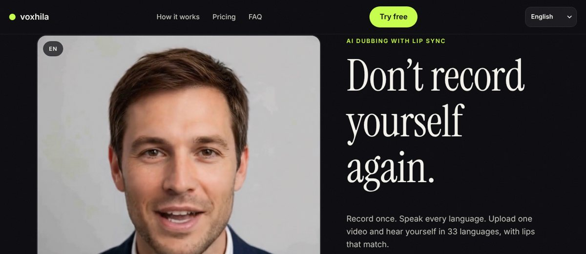</a>

**[voxhila.com](https://voxhila.com)** · Record once. Speak every language.

Upload a video, pick your languages, and get it dubbed into any of 34 languages with matched lip sync. Try a free preview on your own video, no account needed. Built on Cloudflare Workers, Stripe and ElevenLabs.

## Live tools

Every card opens the working tool. No sign-up. AI tools run in your browser with your own API key (Anthropic or Google Gemini), which never leaves your browser except to call that provider.

<table>
<tr>
<td width="50%" valign="top">
<a href="https://emresenturer.github.io/ShortStudio/">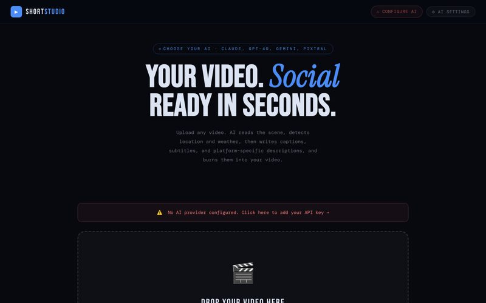</a>
<b><a href="https://emresenturer.github.io/ShortStudio/">ShortStudio</a></b> 
Drop a video. AI reads the scene, location and weather, writes captions, hooks and platform copy, and burns subtitles in. 
<a href="https://emresenturer.github.io/ShortStudio/">Open</a> · <a href="https://github.com/emresenturer/ShortStudio">Source</a>
</td>
<td width="50%" valign="top">
<a href="https://emresenturer.github.io/Lexicon/">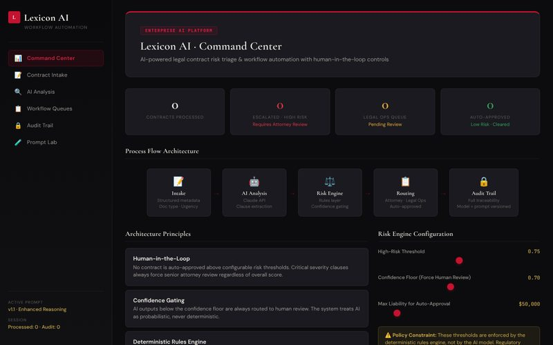</a>
<b><a href="https://emresenturer.github.io/Lexicon/">Lexicon</a></b> 
Legal contract risk triage: clause scoring, human-in-the-loop routing, a full audit trail and a prompt lab. 
<a href="https://emresenturer.github.io/Lexicon/">Open</a> · <a href="https://github.com/emresenturer/Lexicon">Source</a>
</td>
</tr>
<tr>
<td width="50%" valign="top">
<a href="https://emresenturer.github.io/pitchkit/">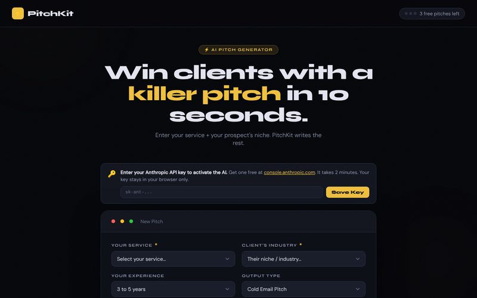</a>
<b><a href="https://emresenturer.github.io/pitchkit/">PitchKit</a></b> 
Cold pitch generator for freelancers and agencies. Pick a service, an industry and a tone; get a pitch ready to send. 
<a href="https://emresenturer.github.io/pitchkit/">Open</a> · <a href="https://github.com/emresenturer/pitchkit">Source</a>
</td>
<td width="50%" valign="top">
<a href="https://emresenturer.github.io/WhatDoYouMean/">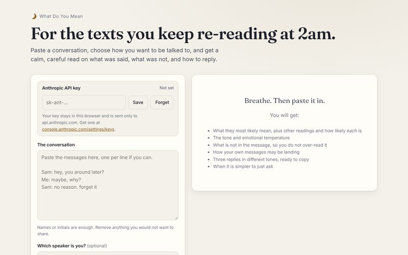</a>
<b><a href="https://emresenturer.github.io/WhatDoYouMean/">WhatDoYouMean</a></b> 
For the texts you keep re-reading at 2am. Likely meanings, tone, what is not being said, and three replies to send. 
<a href="https://emresenturer.github.io/WhatDoYouMean/">Open</a> · <a href="https://github.com/emresenturer/WhatDoYouMean">Source</a>
</td>
</tr>
<tr>
<td width="50%" valign="top">
<a href="https://emresenturer.github.io/ai-business-case-generator/">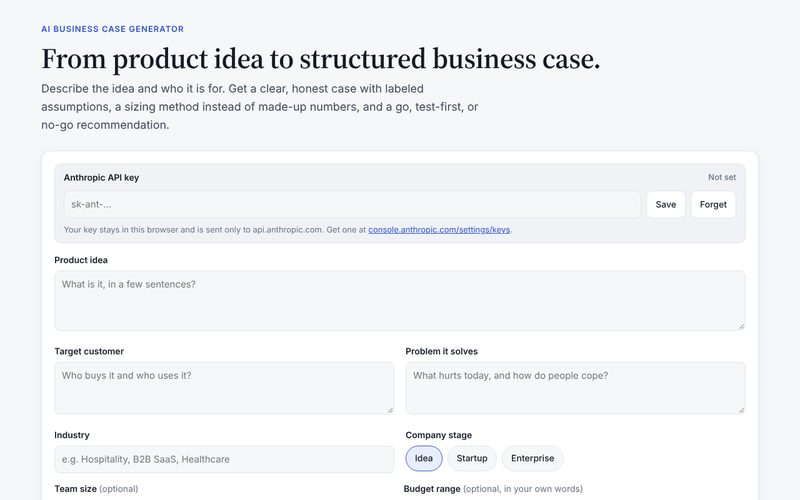</a>
<b><a href="https://emresenturer.github.io/ai-business-case-generator/">Business Case Generator</a></b> 
Turns a product idea into an 11-section business case with labeled assumptions and a go, test-first or no-go call. 
<a href="https://emresenturer.github.io/ai-business-case-generator/">Open</a> · <a href="https://github.com/emresenturer/ai-business-case-generator">Source</a>
</td>
<td width="50%" valign="top">
<a href="https://emresenturer.github.io/Webinsights-AI/">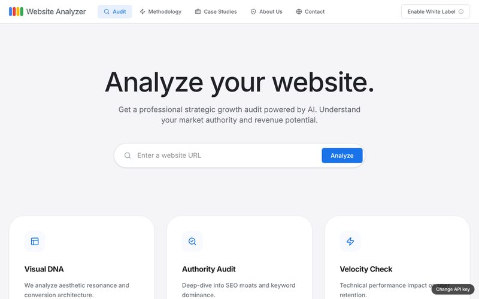</a>
<b><a href="https://emresenturer.github.io/Webinsights-AI/">WebInsights AI</a></b> 
Strategic website audit across design, SEO, content and performance, with a white-label PDF report. 
<a href="https://emresenturer.github.io/Webinsights-AI/">Open</a> · <a href="https://github.com/emresenturer/Webinsights-AI">Source</a>
</td>
</tr>
<tr>
<td width="50%" valign="top">
<a href="https://emresenturer.github.io/Read-with-me-AI/">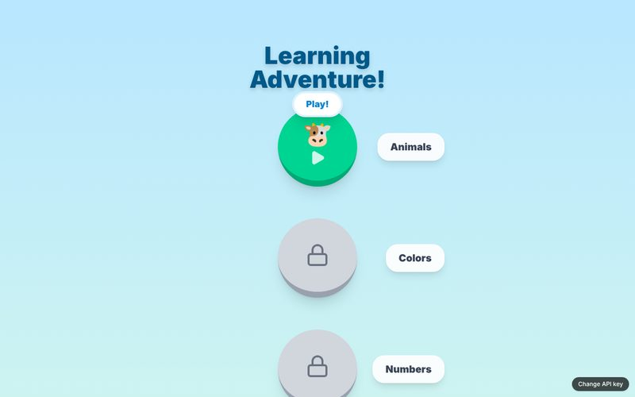</a>
<b><a href="https://emresenturer.github.io/Read-with-me-AI/">Read with Me AI</a></b> 
Voice AI reading tutor for kids. An animated teacher listens, speaks and guides them level by level. 
<a href="https://emresenturer.github.io/Read-with-me-AI/">Open</a> · <a href="https://github.com/emresenturer/Read-with-me-AI">Source</a>
</td>
<td width="50%" valign="top">
<a href="https://emresenturer.github.io/lunas-reading-adventure/">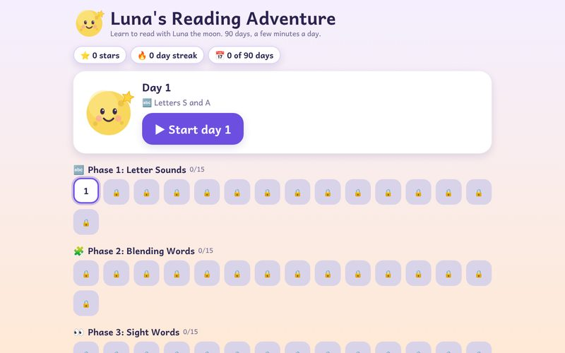</a>
<b><a href="https://emresenturer.github.io/lunas-reading-adventure/">Luna's Reading Adventure</a></b> 
A 90-day, voice-first reading program for ages 4 to 6. No account, no key, progress saved on the device. 
<a href="https://emresenturer.github.io/lunas-reading-adventure/">Open</a> · <a href="https://github.com/emresenturer/lunas-reading-adventure">Source</a>
</td>
</tr>
<tr>
<td width="50%" valign="top">
<a href="https://emresenturer.github.io/ai-banking-market-intelligence/">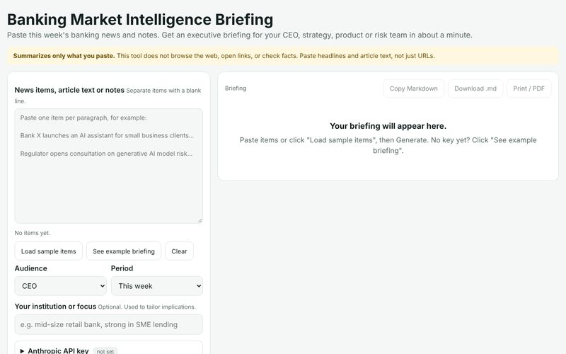</a>
<b><a href="https://emresenturer.github.io/ai-banking-market-intelligence/">Banking Market Intelligence</a></b> 
Paste the week's banking news and get an executive briefing for a CEO, strategy, product or risk team. 
<a href="https://emresenturer.github.io/ai-banking-market-intelligence/">Open</a> · <a href="https://github.com/emresenturer/ai-banking-market-intelligence">Source</a>
</td>
<td width="50%" valign="top">
<a href="https://emresenturer.github.io/ai-competitive-intelligence/">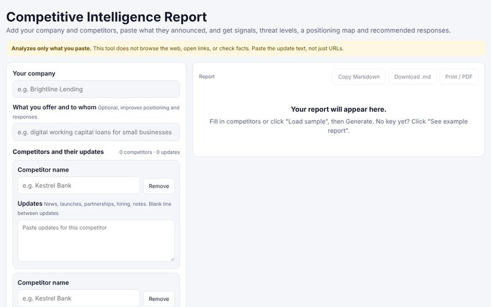</a>
<b><a href="https://emresenturer.github.io/ai-competitive-intelligence/">Competitive Intelligence</a></b> 
Competitor signals, threat levels, a positioning map and recommended responses from the updates you paste. 
<a href="https://emresenturer.github.io/ai-competitive-intelligence/">Open</a> · <a href="https://github.com/emresenturer/ai-competitive-intelligence">Source</a>
</td>
</tr>
</table>

**Also building:** [SparkleNest](https://sparkle-nest-pro.base44.app/), a marketplace that connects homeowners directly with background-checked cleaners across the USA and Canada (MVP, [repo](https://github.com/emresenturer/sparkle-nest)).

## Background

- **NBCUniversal (via Insight Global)** · Lead Business Analyst, UPHE 2.0 Lead-to-Cash; Salesforce/ReleaseForce integrated with SAP S/4HANA (2026 to present)
- **Apple** · Senior Business Analyst, Worldwide Sales Salesforce; personally led 21 of 141 integrations (2022 to 2026)
- **Mattel** · Lead Business Analyst, global trade-spend platform ($1B+ annual)
- **Pacific Life** · six years of Salesforce CRM and reporting, including Classic-to-Lightning migration
- Earlier: Siemens, Microsoft Istanbul, Kelley Blue Book

## Toolbox

**Enterprise:** Salesforce (Sales, Service, Marketing, Experience, Data Cloud, Agentforce, LWC, SOQL) · SAP S/4HANA integrations · MuleSoft · Snowflake · Tableau · Power BI

**Building:** Claude and Gemini APIs · Cloudflare Workers · Stripe · ElevenLabs · React · TypeScript · Python

## Education and languages

- MBA, Marketing · Cal State Fullerton
- B.S., Computer Technology and Information Systems · Bilkent University, Ankara
- English · Turkish · German · French
